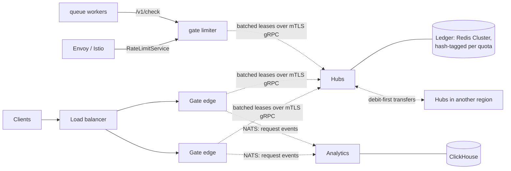
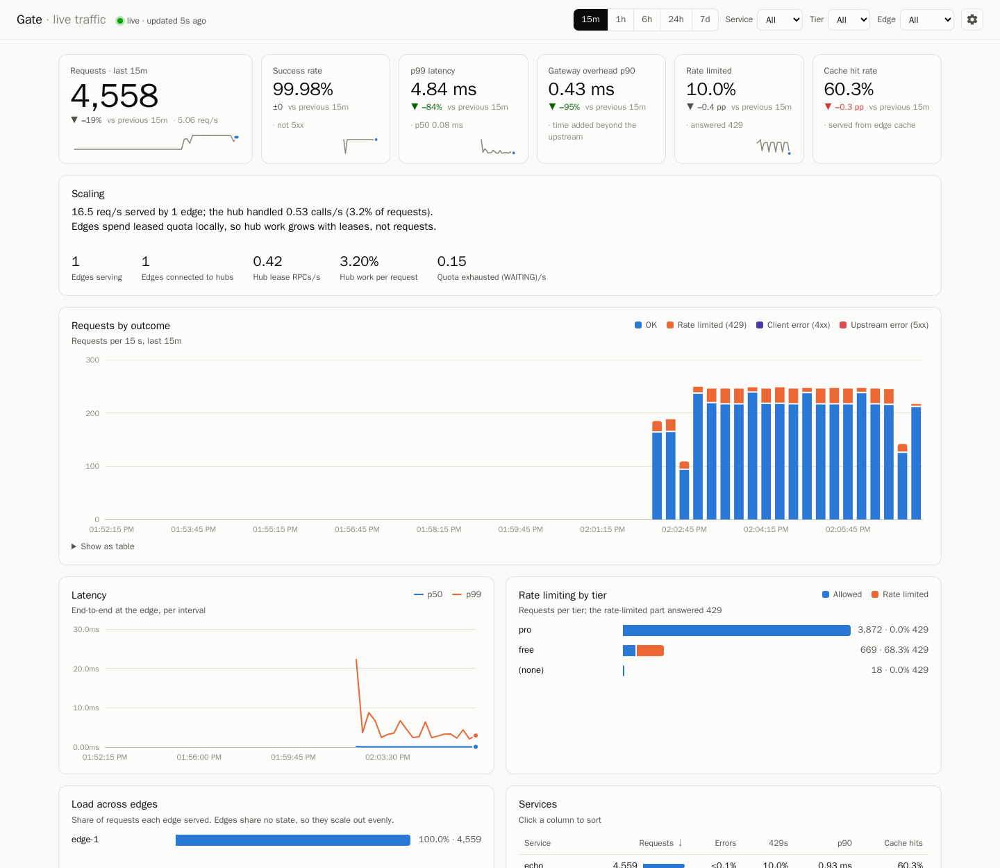

# Gate

[](https://github.com/erdnuz/gateway/actions/workflows/ci.yml)
[](https://github.com/erdnuz/gateway/actions/workflows/loadtest.yml)
[](go.mod)

Gate is a **distributed rate limiter** and the API gateway built around it.
Limits hold exactly and globally — across any number of gateway edges,
Envoy proxies, hub replicas, ledger shards and regions — without a network
round trip per request: edges spend quota leased from a central ledger, in
memory, and the ledger only sees one call per lease.



- **Edges** (data plane) authenticate callers, enforce quotas, cache and
  proxy. They share nothing on the request path, so capacity grows linearly
  with edges.
- **gate limiter** serves the same limits to Envoy (its rate-limit service
  API) and to anything else (a JSON check API), statelessly.
- **Hubs** (control plane) own config, keys and the quota ledger. They are
  stateless over Redis (a single instance or a Cluster), so they replicate
  too, and their work grows with leases, not requests. Several regions each
  run their own and split global quotas between them.
- **Analytics** ingests request events and serves a query API and dashboard.

See [docs/architecture.md](docs/architecture.md) for where state lives and
[the design note](docs/design/distributed-rate-limiting.md) for how the
limiting works.

| | |
| --- | --- |
| Algorithms | fixed window, sliding window, token bucket (GCRA); per-method costs; costs settled after the response (LLM tokens per minute) |
| Limits | per-key tiers; org budgets pooling an owner's keys; extra limits per key, client IP or whole service; shadow (dry-run) mode |
| Accuracy | the ledger's clock defines windows, so no window ever exceeds its quota whatever the clock skew; adaptive grants and an endgame split leave about one token per active edge unused; leases returned on shutdown |
| Scale | batched lease RPCs; hubs balanced client-side; Redis Cluster ledger; multi-region global quotas with debit-first rebalancing |
| Integrations | Envoy/Istio `RateLimitService` and a JSON check/reserve/settle API (`gate limiter`); envoyproxy/ratelimit-style descriptors |
| Verification | ledger conformance (Lua vs Go), a deterministic simulation of edges, hubs and regions under faults on a virtual clock, testcontainers integration tests, load tests with exact per-window checks, a comparative benchmark |
| Gateway | hub-issued API keys, JWT with JWKS, anonymous per-IP callers; replica pools, circuit breaking, retries; caching; CORS; Prometheus, Grafana, OpenTelemetry; RFC 9457 errors; one binary; `gate dev` with no infrastructure |

## Quick start

### 1. Everything in one process: no Docker, no infrastructure

```bash
go run ./cmd/gate dev
```

This starts hub, edge, analytics and a demo echo upstream with embedded Redis
and NATS, issues one key per tier, and prints how to use them:

```text
gate dev is running — embedded Redis and NATS, all state in memory
  gateway     http://127.0.0.1:8080
  hub API     http://127.0.0.1:8081   (Authorization: Bearer dev-…)
  analytics   http://127.0.0.1:8091   (dashboard)
  upstream    http://127.0.0.1:9000   (built-in echo)

API keys:
  freekey      tier free
  prokey       tier pro

Try it:
  curl -i -H "X-API-Key: freekey" http://127.0.0.1:8080/v1/echo/hello
```

The `free` tier allows 20 requests a minute. Request 21 returns `429` with
`RateLimit-Limit`, `RateLimit-Remaining`, `RateLimit-Reset` and `Retry-After`.

No Go toolchain? `make dev` runs the same thing in a container.

### 2. The real topology in Docker

```bash
make demo    # or: bash scripts/dev.sh demo   (where make is unavailable)
```

This runs hub, edge, Redis, an echo upstream, analytics (NATS, ClickHouse)
and observability (Prometheus, Grafana, Jaeger) from
[deploy/compose.yaml](deploy/compose.yaml). Each edge holds one mTLS gRPC
connection to the hub, with certificates generated on first start. A traffic
generator sends steady load across tiers, including one key that keeps
exceeding its quota.

| URL | What |
| --- | --- |
| <http://localhost:8080/v1/echo/hello> | the gateway (`X-API-Key: demopro1`) |
| <http://localhost:8081> | hub admin API (`Authorization: Bearer gate-local-token`) |
| <http://localhost:3000> | Grafana: requests, 429s per tier, hub work per request |
| <http://localhost:8091> | live dashboard: traffic, latency, 429s per tier, load per edge, hub work per request |



### 3. Issue, use and revoke a key

`gate` is the binary from `make build` (`bin/gate`), or `go run ./cmd/gate`.

```bash
export GATE_HUB=http://localhost:8081 GATE_TOKEN=gate-local-token
gate ctl keys create -group v1 -tier pro -owner alice   # prints gk_<id>_<secret> once
curl -H "X-API-Key: gk_..." http://localhost:8080/v1/echo/hello
gate ctl keys revoke <id>                                # every edge rejects it within a second
gate ctl audit
```

Hubs store only the SHA-256 of a key. Edges hash the key as a request
arrives, so the raw key never leaves the edge process: it is not in Redis,
the quota ledger, logs or metrics.

`make up` starts the same stack without demo traffic. `make down` stops it,
and `make clean` also removes its volumes.

## The `gate` binary

One binary runs every component:

```text
gate dev                 hub + edge + analytics + limiter in one process, no external services
gate hub                 control plane          (configured by environment)
gate edge                gateway data plane     (configured by environment)
gate limiter             the rate limiter as a service: Envoy RLS + JSON API
gate analytics           analytics + dashboard  (configured by environment)
gate echo                demo upstream that echoes each request as JSON
gate config validate F   check a config file and list every problem with its line
gate config migrate F    convert a version 1 JSON config to version 2 YAML
gate config schema       print the JSON Schema used for editor completion
```

## Configuration

A gateway config is a short YAML file. Durations are written like `1m`, and
everything not shown here has a working default:

```yaml
version: 2
services:
  - name: orders
    match: { path_prefix: /v1/orders }
    upstream: http://orders:8080
    limits:
      window: 1m
      tiers:
        free: { requests: 60 }
        pro:  { requests: 6000 }
```

See [examples/](examples) and [docs/configuration.md](docs/configuration.md).

## How rate limiting works

Each edge asks the hub for a *lease*, a batch of tokens for one key, service
and quota window. It then spends those tokens locally, in memory. It renews
in the background when the balance runs low, and drops leftover tokens when
the window rolls over. The hub's ledger is the single source of truth, so the
global limit holds however many edges serve a key. If the hub is unreachable,
edges keep serving under a local per-window *safety* quota instead of failing
closed. The [design note](docs/design/distributed-rate-limiting.md) covers the
trade-offs, sequence diagrams and failure modes.

The [load test](testing/loadtest/README.md) checks these properties against a
production-shaped stack: exact admission per window, no carry-over between
windows, isolation between services, propagation to every edge, and
behaviour during a hub outage. See the
[before/after results](testing/loadtest/results/COMPARISON.md).

## The limiter without the gateway

`gate limiter` answers Envoy's `envoy.service.ratelimit.v3.RateLimitService`
and a JSON API from the same global quota, so Envoy, Istio and non-HTTP
workloads get exact global limits too. Descriptors use envoyproxy/ratelimit's
config shape:

```yaml
descriptors:
  - domain: ingress
    entries:
      - key: remote_address
        limit: { requests: 100, window: 1s }
```

```bash
curl -s localhost:8082/v1/check -d '{"domain":"demo","descriptors":[{"entries":[{"key":"user","value":"alice"}]}]}'
```

See [docs/limiter.md](docs/limiter.md).

## Evidence

- `make sim` runs generated scenarios — 1–6 edges, three algorithms, clock
  skew up to ±500 ms, drains, post-hoc costs, and RPC faults (latency, drops,
  lost replies, duplicates, hub outages) — on a virtual clock against the
  real edge and hub code, and checks that no window ever exceeds its quota.
  The multi-region variant adds partitions between regions.
  ([verification](docs/design/verification.md))
- `make loadtest` checks exact per-window admission (`<= Q`, using the
  `Gate-Window` header), carry-over, endgame splitting, lease return on
  drain, batching, the algorithms, multiple limits, post-hoc cost and the
  decision service on a Docker stack.
- `testing/bench/run.sh` compares Gate with a central Redis counter and
  with Envoy plus envoyproxy/ratelimit ([benchmarks](docs/benchmarks.md)).

## Development

```bash
make test               # go vet + unit tests with the race detector
make test-integration   # testcontainers suite (Redis, NATS)
make sim                # deterministic simulation (ARGS=N scenarios)
make loadtest           # end-to-end rate-limiter load test
make help               # everything else
```

Targets use a local Go toolchain when present and a `golang:1.26` container
otherwise.

## Repository layout

| Path | Contents |
| --- | --- |
| `cmd/gate` | the single binary |
| `internal/app` | per-component wiring (`hubapp`, `edgeapp`, `analyticsapp`) and the in-process dev stack |
| `packages/ledger` | the quota ledger: grant, return and transfer scripts (Lua) and their in-memory twin |
| `packages/limiter` | the edge side: `Lease` (global quota from hub leases), `Reserve` (multiple limits, settlement), `Batcher`, `Local` (per-edge safety limit) |
| `packages/decide`, `packages/rls` | the decision service: descriptor matching, the JSON API, Envoy's RateLimitService |
| `packages/region` | splitting global quotas between regions |
| `packages/edge`, `packages/hub`, `packages/analytics` | component logic |
| `packages/config` | config file format: parsing, validation, migration, JSON Schema |
| `packages/common` | shared runtime types, RFC 9457 problems and request IDs (`httpx`), env helpers, readiness |
| `api/proto` | hub ↔ edge lease protocol |
| `deploy` | Dockerfile, compose stack, dev certificate generator |
| `examples`, `schema` | gateway config examples and their JSON Schema |
| `testing` | integration scenarios, the simulation (`sim`), the load test and the benchmark |

## Documentation

- [Architecture](docs/architecture.md) and [distributed rate limiting](docs/design/distributed-rate-limiting.md)
- [Algorithms](docs/design/algorithms.md), [multi-region quotas](docs/design/multi-region.md), [verification](docs/design/verification.md), [benchmarks](docs/benchmarks.md)
- [gate limiter](docs/limiter.md): Envoy and the JSON API
- Decisions: [leases](docs/adr/0001-leases-over-central-counting.md), [one gRPC control plane](docs/adr/0002-one-grpc-control-plane.md), [edges share nothing](docs/adr/0003-edges-share-nothing.md), [config v2](docs/adr/0004-config-v2.md), [ledger clock](docs/adr/0005-ledger-clock-and-interface.md), [adaptive leases](docs/adr/0006-adaptive-leases-and-endgame.md), [batching](docs/adr/0007-batched-unary-over-streams.md), [multiple limits](docs/adr/0008-multi-limit-and-org-budgets.md), [post-hoc cost](docs/adr/0009-reservations-and-debt.md), [decision service](docs/adr/0010-decision-service.md), [Redis Cluster](docs/adr/0011-redis-cluster-hash-tags.md), [regions](docs/adr/0012-multi-region-debit-first.md)
- [Hub admin API (OpenAPI)](api/openapi/hub.yaml)
- [Observability](docs/observability.md): metrics, the Grafana dashboard, tracing
- [Configuration](docs/configuration.md)
- [Deployments](docs/deployments.md) and [multi-host deployment](docs/deploy-multi-host.md)
- [Edge](docs/edge.md), [Hub](docs/hub.md), [Analytics](docs/analytics.md)
