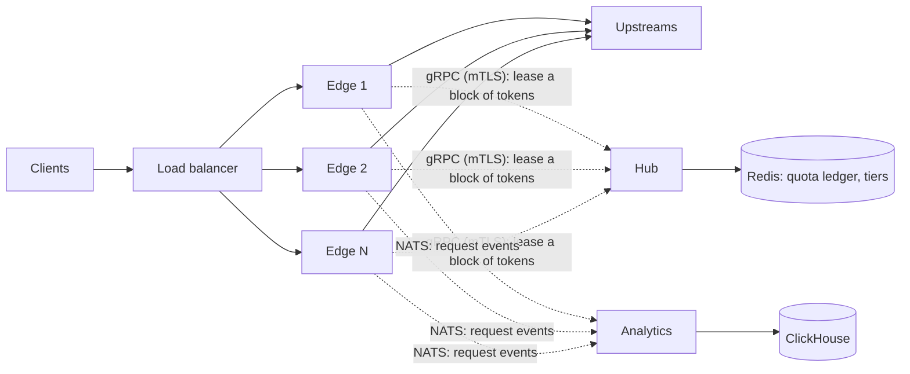

# Architecture

Gate is built so that the request path scales out. Edges keep no shared state
on the hot path: every edge can be added, removed or restarted without
coordinating with the others, and the control plane sees work that grows with
the number of *leases*, not the number of requests.

| Plane | Service | Holds |
| --- | --- | --- |
| Data | edge | config snapshot, leased tokens, tier and response caches |
| Control | hub | the authoritative quota ledger, key tiers, the config |
| Observability | analytics | request events and their aggregates |

## Where state lives

Scaling is mostly a question of where state lives and who has to agree on it.

| State | Lives in | Shared by | On the request path? |
| --- | --- | --- | --- |
| Quota ledger (key × service × window) | hub Redis, updated by one Lua script per lease | all edges, through the hub | no, only on a lease miss |
| Leased tokens | edge process memory | nobody | yes: a few atomic operations |
| Config | edge memory, swapped atomically on reload | nobody | yes: lock-free read |
| Key → tier | edge Redis cache, filled from the hub | nobody | yes, on a cache miss only |
| Cached responses | edge Redis | nobody | yes |
| Request events | bounded edge buffer, then NATS | analytics consumers | no: published asynchronously |

Nothing on the request path is shared between edges, so N edges serve N times
the traffic of one.

## Distributed rate limiting by leasing

A global limit ("1000 requests per minute for this key, across all edges")
normally needs a shared counter that every request updates. Gate avoids that
round trip:

1. On the first request for a key, the edge asks the hub for a **lease**: a
   block of tokens (default 100) from the key's quota for the current window.
2. Requests spend tokens from process memory
   ([`limiter.Lease`](../packages/limiter/lease.go)), about 100–250 ns per decision.
3. At the low-water mark (20% of a lease) the edge renews **in the
   background**, so steady traffic never waits on the hub.
4. Windows are epoch-aligned (`unix / window`). Every edge and the hub agree
   on window boundaries without talking to each other, and leftover tokens are
   dropped when a window ends so they cannot inflate the next one.
5. When the hub's ledger is exhausted it answers **WAITING** with a retry time.
   The edge spends what it holds and then denies locally, and asks again only
   after a jittered retry, so a hot key cannot stampede the hub.

The hub's ledger is exact, so the limit holds however many edges serve a key.
Lease size is the knob between hub load and fairness:

- **Hub load** is about `requests / lease size`: 10,000 rps at a lease of 100 is
  about 100 lease RPCs per second, whether those requests hit 2 edges or 50.
- **Stranded tokens**: near the end of a window, idle edges may hold tokens a
  busy edge cannot use. At most `(edges − 1) × lease size` per key per window.
  Edges can never admit more than the limit.

Concurrent misses for one key share a single RPC (singleflight). A hub
outage costs one RPC per 500 ms backoff, not one per request.

## The edge request path

[`edge.NewServer`](../packages/edge/server.go) composes one middleware chain.
Each step reads and fills a typed per-request state:

| Step | File | Does |
| --- | --- | --- |
| request ID | [`httpx`](../packages/common/httpx/httpx.go) | accept or mint `X-Request-Id`, echo it, propagate it upstream |
| analytics | [`analytics.go`](../packages/edge/analytics.go) | record status, size and latency; publish without blocking |
| route | [`route.go`](../packages/edge/route.go) | `/{group}/{service}/…` to a configured service |
| CORS | [`route.go`](../packages/edge/route.go) | answer preflights before authentication |
| auth | [`auth.go`](../packages/edge/auth.go) | API key to tier, with stale or default fallback if the hub is down |
| cache | [`cache.go`](../packages/edge/cache.go) | serve hits (they cost no quota); store bounded, cacheable misses |
| rate limit | [`ratelimit.go`](../packages/edge/ratelimit.go) | charge the quota; `RateLimit-*` and `Retry-After` headers |
| proxy | [`proxy.go`](../packages/edge/proxy.go) | `httputil.ReverseProxy` plus a retrying transport and the failure policy |

Every error is an RFC 9457 `application/problem+json` body with a stable
`code` (`rate_limited`, `invalid_api_key`, `upstream_timeout`, …) and the
request ID.

## Failure modes

| Failure | Effect | Why |
| --- | --- | --- |
| Hub down | Edges spend the tokens they hold, then apply the service's `when_hub_unavailable` limit per edge, or return 503 | the data plane degrades instead of stopping; edge readiness ignores the hub so the load balancer does not drain every edge at once |
| Hub slow or overloaded | Renewals are asynchronous and coalesced; WAITING retries are jittered | hub latency stays off the request path |
| Edge Redis down | `/readyz` fails after 3 probes and the load balancer drains that edge | one edge's local dependency affects only that edge |
| NATS down | Analytics events are dropped from a bounded buffer | requests never wait on observability |
| Edge crash | Its unspent tokens are lost for the rest of the window | bounded by one lease per active key |

## Scaling each tier

- **Edges** scale horizontally behind any load balancer, and need no sticky
  sessions. Each edge's memory grows with its active key set: idle keys are
  evicted after a minute.
- **Hub** work grows with lease RPCs, not requests. Each grant is one atomic
  Redis script, so the ledger stays correct with concurrent callers.
- **Analytics** consumers join a NATS queue group, so ingestion scales by adding
  consumers. ClickHouse handles the aggregate queries.

## Code map

| Package | Role |
| --- | --- |
| [`packages/limiter`](../packages/limiter) | `Limiter` interface; `Lease` (global quota via hub leases) and `Local` (per-edge safety limit) |
| [`packages/edge`](../packages/edge) | data plane: the middleware chain above, config and tier caches |
| [`packages/hub`](../packages/hub) | control plane: lease ledger (gRPC), tiers, config reloads |
| [`packages/analytics`](../packages/analytics) | event ingestion, storage, dashboard |
| [`packages/config`](../packages/config) | config file format: parsing, validation, migration, JSON Schema |
| [`packages/common/httpx`](../packages/common/httpx) | problem responses, request IDs, key redaction |
| [`internal/app`](../internal/app) | per-service wiring, and `gate dev` (everything in one process) |
