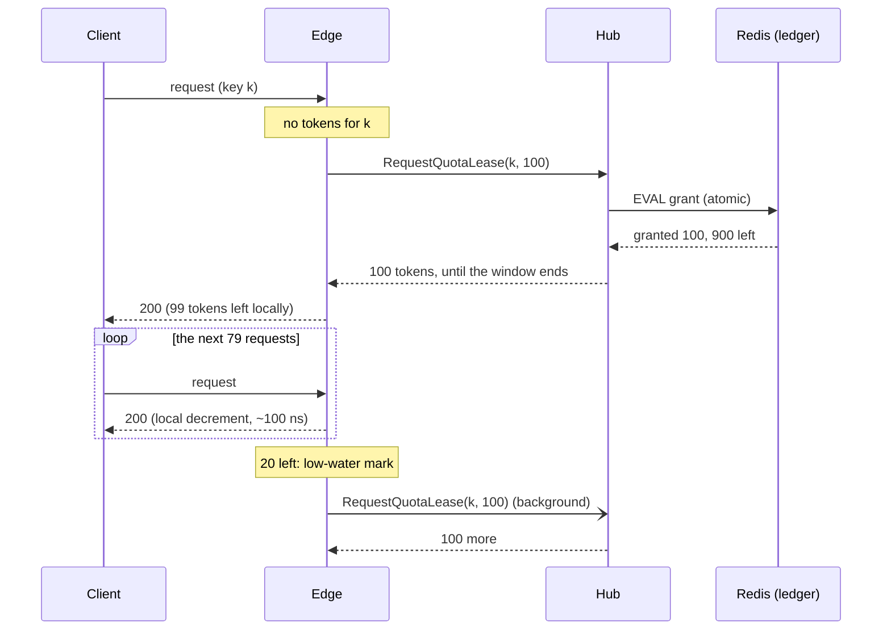
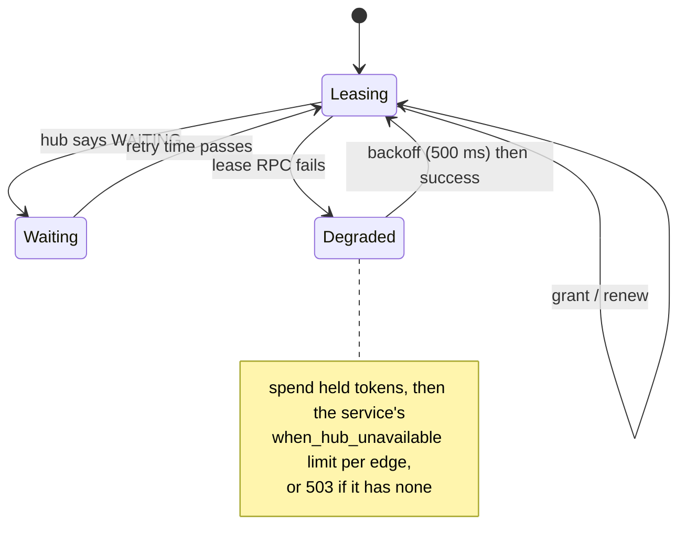

# Distributed rate limiting by quota leasing

How Gate enforces one global limit per key across any number of edges
without a shared counter on the request path.

## The problem

A tier says "1,000 requests per minute for this key". Requests for the key
arrive at any of N edges. The textbook options:

| Approach | Request path cost | Accuracy | Scales with |
| --- | --- | --- | --- |
| Central counter (Redis `INCR` per request) | one network round trip | exact | the counter's throughput |
| Local limits (limit / N per edge) | none | wrong when traffic is uneven, and N changes | edges, but inaccurately |
| Gossip / CRDT counters | none | eventually consistent; overshoots during convergence | edges, with O(N) messages |
| **Leases** (Gate) | none on a hit; one RPC per lease | never over the limit; bounded under-use | edges; hub work ∝ requests / lease size |

## Leases

The hub owns the ledger: for each key, service and window, how many tokens it
has granted. Edges ask for tokens in blocks and spend them locally.

The details that make this correct:

- **Epoch-aligned windows.** A window is `unix_time / period`. Edges and the
  hub compute the same boundaries independently, so no clock coordination
  is needed beyond NTP-level agreement. The integration suite includes
  clock-skew scenarios.
- **Leftover tokens die with their window.** When a window rolls, an edge
  drops what it holds, because the hub has already started counting the new
  window from zero. Without this, a quiet edge could carry tokens into a new
  window and the key would exceed its limit (the load test's `carryover`
  scenario checks for this).
- **A local guard.** An edge never admits more than the whole limit in one
  window, whatever the hub grants (for example right after the limit is
  lowered).
- **Coalesced misses.** When many requests for one key miss at once, they
  share a single RPC (singleflight). A miss after a refill (peers drained it
  first) retries instead of reporting a false 429.
- **WAITING.** When the ledger is exhausted the hub answers WAITING with a
  retry time. The edge spends what it still holds, then denies locally and
  asks again only after the retry time plus jitter. A hot key at its limit
  costs the hub one RPC per edge per retry interval, not one per request.

## Accuracy

- **Never over the limit.** Every admitted request spent a token the ledger
  granted exactly once.
- **Bounded under-use.** Near the end of a window, tokens held by quiet edges
  cannot help a busy one: at most `(edges − 1) × lease size` per key per
  window. Smaller leases mean less stranding and more hub RPCs. The lease size
  can be set per service (`limits.lease_size`).

Measured on the load-test stack (two edges, limit 1,000 per 10-second
window, offered 2× the limit): every window admitted 1,000 to 1,002, split
500/500 across the edges ([report](../../testing/loadtest/results/phase3/report.md)).

## Failure modes

- **Hub unreachable.** Edges spend what they hold, then apply the service's
  `when_hub_unavailable` limit locally (per edge), or refuse with 503. Lease
  RPCs back off for 500 ms after a failure, so an outage does not turn into
  a retry storm, and recovery does not stampede the hub.
- **Edge crash.** Its tokens are lost for the rest of the window: at most one
  lease per active key.
- **Hub restart.** The ledger is in Redis, so nothing is lost. Edges reconnect
  and resynchronise from the snapshot that opens every watch stream.

## Where the code is

- [`packages/limiter/lease.go`](../../packages/limiter/lease.go): the edge
  side (about 250 lines).
- [`packages/hub/quota_lease_server.go`](../../packages/hub/quota_lease_server.go):
  the hub side and its Lua grant script.
- [`testing/loadtest`](../../testing/loadtest): the scenarios that check all
  of the above end to end.
