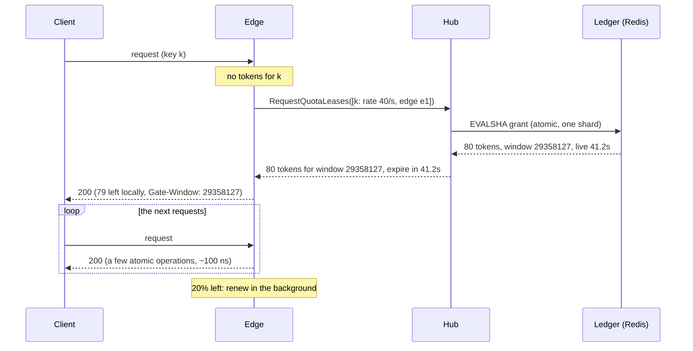
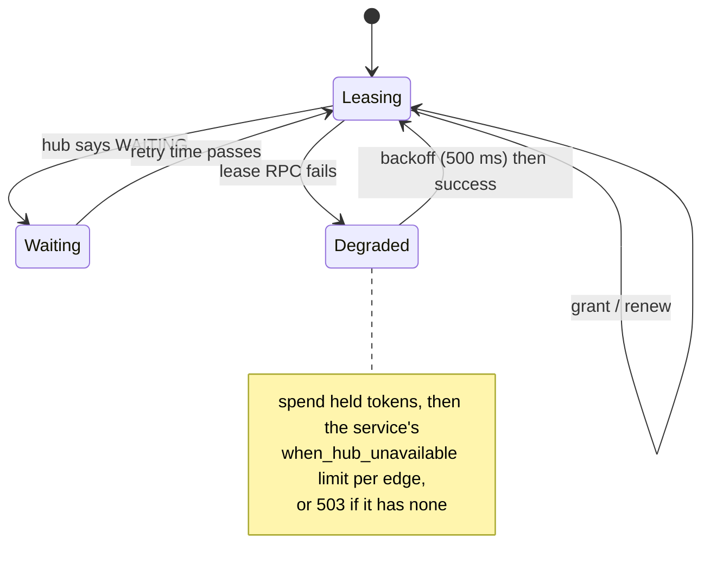

# Distributed rate limiting by quota leasing

How Gate enforces one global limit per key across any number of edges,
replicated hubs, a sharded ledger and several regions, without a shared
counter on the request path.

## The problem

A tier says "1,000 requests per minute for this key". Requests for the key
arrive at any of N edges. The textbook options:

| Approach | Request path cost | Accuracy | Scales with |
| --- | --- | --- | --- |
| Central counter (Redis `INCR` per request) | one network round trip | exact | the counter's throughput |
| Local limits (limit / N per edge) | none | wrong when traffic is uneven, and N changes | edges, but inaccurately |
| Gossip / CRDT counters | none | eventually consistent; overshoots during convergence | edges, with O(N) messages |
| **Leases** (Gate) | none on a hit; one batched RPC per grant | never over the limit; about one token per active edge unused | edges, hubs and ledger shards independently |

## Leases

The hub owns the ledger: for each quota and window, how many tokens it has
granted. Edges ask for tokens in blocks and spend them locally.

What makes it correct:

- **The ledger's clock defines windows** ([ADR 5](../adr/0005-ledger-clock-and-interface.md)).
  A grant names its window and how long its tokens live, measured from the
  grant. The edge measures that lifetime from when it *sent* the request, so
  its expiry is never later than the ledger's, and keeps one balance per hub
  window. Clock skew between edges and hubs cannot move a token into the
  wrong window.
- **Leftover tokens die with their window.** The hub has already started the
  next window from zero.
- **A local guard.** An edge never admits more than a whole fixed-window
  quota in one window, whatever it is granted (for example right after a
  quota cut).
- **Coalesced misses.** Concurrent misses for one key share one fetch
  (singleflight); concurrent fetches for different keys share one batched
  RPC ([ADR 7](../adr/0007-batched-unary-over-streams.md)).
- **WAITING.** An exhausted quota answers WAITING with a retry time. Edges
  spend what they hold, deny locally, and ask again only after the retry
  time plus jitter: a hot key at its limit costs one RPC per edge per retry
  interval.

## Sizing grants: adaptive, with an endgame split

([ADR 6](../adr/0006-adaptive-leases-and-endgame.md))

Each edge reports what it spends on a key per second; the hub grants the
larger of the lease size and `rate × horizon` (2 s by default). Busy keys get
large grants and few hub calls.

Near the end of a quota (less than 64 grants left), the grant script divides
what is left between the edges active on it (a sorted set of edges seen in
the last 2 horizons): once `remaining < active edges × target`, each grant
is `ceil(remaining / active edges)`. Quota stranded on quiet edges at the end of
a window falls from `(edges − 1) × lease size` to about one token per active
edge. On graceful shutdown, and when a key goes idle, an edge returns its
unspent tokens, credited once to the window they came from.

## Accuracy

- **Never over the limit.** Every admitted request spent a token granted
  once, in its window. With post-hoc costs, at most `edges × max_debt` over
  ([ADR 9](../adr/0009-reservations-and-debt.md)).
- **Bounded under-use**, about one token per active edge per quota.
- Measured: 1000 simulated scenarios with faults, clock skew and drains
  never exceed the quota, and saturated ones use 99% of it on average; in
  the load test every window admits exactly Q (1000 of 1000), attributing
  requests by the `Gate-Window` header. Leasing costs the ledger about a
  tenth of a per-request counter's work when keys are busy, and more when
  nearly every request is a key's first in its window
  ([benchmarks](../benchmarks.md)).

## Algorithms and multiple limits

Fixed windows, sliding windows and GCRA token buckets all run through the
same grant path ([algorithms](algorithms.md)). A request may need to fit
several limits: its tier, the owner's org budget (granted atomically with
the key's), and limits per client address or per service; a denial by any
refunds the others locally ([ADR 8](../adr/0008-multi-limit-and-org-budgets.md)).
Shadow limits report what they would deny without denying.

## Failure modes

- **Hub unreachable.** Edges spend what they hold, then apply the service's
  `when_hub_unavailable` limit locally (per edge), or refuse with 503. Lease
  RPCs back off for 500 ms after a failure.
- **Edge crash.** Its tokens are lost for the rest of the window: at most one
  grant per active quota, small with adaptive grants. A graceful stop returns
  them.
- **Hub restart.** The ledger is in Redis; edges reconnect (to any hub
  replica) and resynchronise from the snapshot that opens every watch stream.
- **Region partition.** Each region keeps its allocation of global quotas
  and stops rebalancing; regions together never exceed the quota
  ([multi-region](multi-region.md)).

## Scaling

| Tier | State | Scales by | Work grows with |
| --- | --- | --- | --- |
| Edges, gate limiter | tokens in memory | adding replicas | requests |
| Hubs | none (over Redis) | adding replicas (`dns:///` + `round_robin`) | grants, not requests |
| Ledger | Redis Cluster, hash-tagged per quota | adding shards | grants |
| Regions | one ledger each | adding regions | transfers, only when demand moves |

## Where the code is

- [`packages/ledger`](../../packages/ledger): the grant, return and transfer
  scripts and their in-memory twin.
- [`packages/limiter`](../../packages/limiter): the edge side (`Lease`,
  `Reserve`, `Batcher`).
- [`packages/hub/quota_lease_server.go`](../../packages/hub/quota_lease_server.go):
  resolving a request to a quota.
- [`packages/region`](../../packages/region): allocation and rebalancing.
- [`testing/sim`](../../testing/sim) and [`testing/loadtest`](../../testing/loadtest):
  the evidence ([verification](verification.md)).
