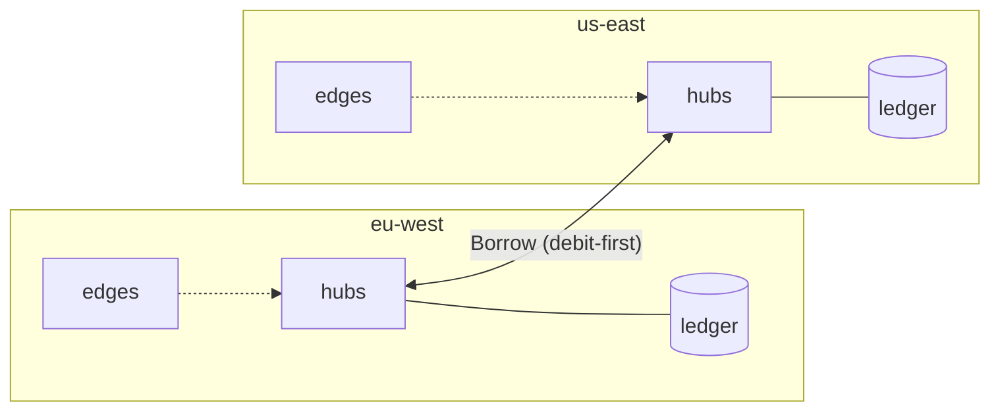

# Global quotas across regions

A quota of 1,000 requests a minute per key, enforced across every region,
with no cross-region call on the request or lease path, and no overshoot
when regions cannot talk to each other.



## Allocation

Each region's ledger enforces its **allocation** of every global quota:

- its **floor**, `floor(Q × share)` (`limits.global.floors`), plus
- if it is the key's **home region**, the remainder `Q − Σ floors`.

The home region is chosen by rendezvous hashing of (region, key), so every
region computes the same split independently and allocations sum to exactly
Q. Floors guarantee each region a share; the remainder spreads homes evenly
across regions.

```yaml
services:
  - name: search
    limits:
      window: 1m
      tiers: { pro: { requests: 60000 } }
      global: { floors: { eu-west: 0.25, us-east: 0.25, ap-south: 0.1 } }
```

Hubs learn their region from `HUB_REGION` and reach peers through
`HUB_REGION_PEERS=us-east=dns:///hub.us-east:9090,...` over mTLS.

## Rebalancing

When a grant finds a region's allocation exhausted, the hub records the
quota. Every 250 ms its node asks peers, in rotating order, to lend a quarter
of Q for that window:

1. The **lender** checks the window is still current on its clock, keeps
   back what it is on pace to use for the rest of the window
   (`used × remaining / elapsed`), **debits its own allocation**, records the
   amount under the transfer ID, and replies. A retry with the same ID gets
   the same answer and lends nothing more.
2. The **borrower** credits the amount to its allocation for that window,
   once per transfer ID, and only if the window is still current.

## Why the regions never exceed Q

Allocations start summing to Q. A transfer only ever moves allocation: the
lender's decrement happens (atomically, in its ledger) before any increment
can, and the increment happens at most once. Anything that goes wrong
between the two — a lost reply, a crashed borrower, a partition, a window
that ended in transit — means the lender's decrement is never matched:
under-use, never overshoot. A region that cannot reach its peers keeps its
allocation and simply stops borrowing.

This is checked by the multi-region simulation: 200 generated scenarios with
2–3 regions, demand moving between them, and a network that drops,
duplicates, loses replies and partitions. No key ever exceeds Q across
regions in any window.

## What it costs

- **Utilization while demand moves.** Borrowing takes a few 250 ms rounds,
  so after demand shifts, the busy region is short until it has borrowed.
  In the simulation, fault-free scenarios with 2–5 s windows use 91% of the
  global quota on average; longer windows do better, very short windows
  with zero floors worse. Floors trade guaranteed local capacity against
  how much can move.
- **Clock skew between regions.** Each region enforces its allocation in
  windows of its own ledger's clock; relative to a single global clock, a
  skew of ε lets a boundary shift by ε. Keep regional clocks NTP-synced;
  transfers near a boundary under skew are dropped, never doubled.
- **Scope.** Global quotas are fixed-window tier limits. API keys must exist
  in every region (a shared or replicated key store).
