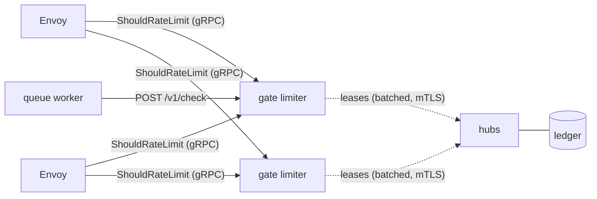

# gate limiter: the rate limiter as a service

`gate limiter` serves Gate's leased, global rate limiting to anything that
is not the Gate gateway:

- **Envoy** and everything built on it (Istio, Contour, Emissary, Gloo),
  through Envoy's own rate-limit service API,
  `envoy.service.ratelimit.v3.RateLimitService`;
- **anything else** (queue consumers, batch jobs, other gateways) through a
  small JSON API.

It is stateless like an edge: it leases quota from the hub, follows the hub's
config, and scales out behind a load balancer. Limits hold exactly across
every Envoy and every limiter replica.



## Configure descriptors

Descriptors go in the same config file as services, in envoyproxy/ratelimit's
shape ([examples/envoy-ratelimit.yaml](../examples/envoy-ratelimit.yaml)):

```yaml
descriptors:
  - domain: ingress
    entries:
      - key: remote_address               # one limit per client address
        limit: { requests: 100, window: 1s }
      - key: generic_key
        value: checkout                    # only this value
        limit: { algorithm: token_bucket, rate: 50/s, burst: 100 }
        entries:
          - key: user_id                   # nested: checkout per user
            limit: { requests: 1000, window: 1m }
            mode: shadow                   # report, never deny
```

Matching follows Envoy's rate-limit service: entries are matched in order,
an entry with a `value` beats one without, an entry without a `value` gives
every value its own counter, and the limit is the one on the entry the
descriptor ends at. Values are hashed before they reach the ledger.

Differences from envoyproxy/ratelimit worth knowing:

- Limits are exact and global without a Redis round trip per request:
  decisions come from tokens leased to each limiter replica.
- Windows can be any length (`90s`, `6h`), and sliding windows and token
  buckets are available.
- When one descriptor in a request is over its limit, the others are
  refunded rather than charged.

## Run it

```bash
HUB_GRPC_ADDR=dns:///hub:9090 HUB_GRPC_SERVER_NAME=hub-server \
LIMITER_TLS_CERT_FILE=... LIMITER_TLS_KEY_FILE=... LIMITER_TLS_CA_FILE=... \
LIMITER_SECRET=$(openssl rand -hex 32) \
gate limiter
```

| Variable | Default | |
| --- | --- | --- |
| `PORT` | `8080` | JSON API, `/healthz`, `/readyz` |
| `LIMITER_GRPC_PORT` | `8081` | Envoy's RateLimitService |
| `HUB_GRPC_ADDR`, `HUB_GRPC_SERVER_NAME` | | the hub, as for an edge |
| `LIMITER_TLS_CERT_FILE`, `_KEY_FILE`, `_CA_FILE` | | mTLS identity towards the hub |
| `LIMITER_SECRET` | | signs reservations; replicas that settle each other's must share it |
| `LIMITER_TOKEN` | | bearer token required by the JSON API |
| `METRICS_ADDR` | `:9100` | Prometheus metrics |

`gate dev` runs one on `127.0.0.1:8082` (JSON) and `:8083` (gRPC) with a demo
domain.

## Envoy

```yaml
http_filters:
  - name: envoy.filters.http.ratelimit
    typed_config:
      "@type": type.googleapis.com/envoy.extensions.filters.http.ratelimit.v3.RateLimit
      domain: ingress
      failure_mode_deny: false        # when the limiter is unreachable
      rate_limit_service:
        transport_api_version: V3
        grpc_service:
          envoy_grpc: { cluster_name: gate_limiter }
```

with a route-level `rate_limits` action producing the descriptors (for
example `remote_address`). Gate answers with per-descriptor statuses,
`OVER_LIMIT` when any enforced descriptor is over, and adds `RateLimit-Limit`,
`RateLimit-Remaining`, `RateLimit-Reset` and (on denial) `Retry-After` for
the binding descriptor. An unreachable ledger is a gRPC `UNAVAILABLE`, so
Envoy's `failure_mode_deny` decides.

For Istio, the same filter goes in an `EnvoyFilter` patching the
`HTTP_FILTER` list of the gateway or sidecar, with a `gate_limiter` cluster
pointing at the limiter service.

## JSON API

```bash
curl -s localhost:8082/v1/check -d '{
  "domain": "jobs",
  "descriptors": [{"entries": [{"key": "tenant", "value": "acme"}], "cost": 1}],
  "max_wait_ms": 2000,
  "reserve": true
}'
```

```json
{"allowed": true, "reservation": "eyJk...",
 "statuses": [{"limit": "tenant", "matched": true, "allowed": true, "limit_value": 600, "remaining": 412, "reset_ms": 31877, "window": 29358127}]}
```

- A decision is always `200`; `allowed` says which. `503` means the ledger is
  unreachable.
- `max_wait_ms` (up to 30 s) makes a denied check wait for quota and retry,
  so a worker can simply block on it.
- `reserve: true` returns a reservation. When the real cost is known, settle
  it from any replica:

```bash
curl -s localhost:8082/v1/settle -d '{"reservation": "eyJk...", "actual": 3}'
```

The difference from the reserved cost is credited to (or charged from) the
ledger window the reservation came from, exactly once.
